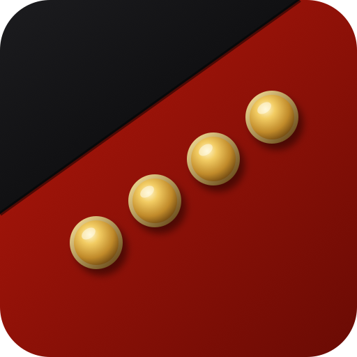

# Make it So

**Steve Dalton and Matt Paine**, two space nerds from the Gold Coast, Australia, entering the
[NASA International Space Apps Challenge 2026](https://www.spaceappschallenge.org/) at the Gold Coast event, 14–15 November 2026.

We love maps: we've built plenty of mapping systems for projects here on Earth. Steve grew up on Apollo cutaways, Matt is a keen astronomer, and we're both radio amateurs. Mapping the Moon is a match made in heaven.

Our name is a tribute to the late, great Sir Patrick Stewart, our favourite Star Trek captain.

Our hackathon project goes up here, and at **[gcsa.space](https://gcsa.space)**, once the event starts. Make it so.
